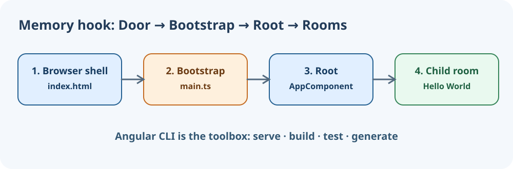

# Module 01 — Angular Foundation

**Story:** Aarav launches a learner-facing training desk, learning how Angular starts, builds and displays a greeting. Keep the project running during lessons.

1. [Introduction to Angular](./01-introduction-to-angular.md)
2. [Angular Latest Version Overview](./02-angular-latest-version-overview.md)
3. [Angular Architecture Overview](./03-angular-architecture-overview.md)
4. [Angular CLI and Its Uses](./04-angular-cli-and-its-uses.md)
5. [Angular CLI Commands](./05-angular-cli-commands.md)
6. [Your First Angular Hello World Project](./06-hello-world-project.md)

## Acceptance gates
- Explain the bootstrapping flow without notes.
- Demonstrate Hello World as a true imported standalone child component.
- Confirm supported Node version, Angular CLI version, build and test.
- Save browser screenshots and terminal test results.

**Next:** [Module 02 — Components & Templates](../module-02-components-templates/README.md).

