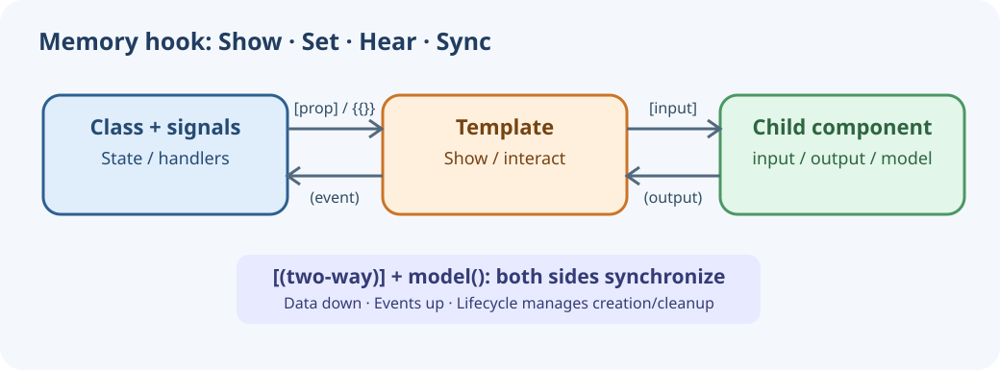

# Module 02 · Lesson 12 — Component Styles

**Learning outcome:** Differentiate local component CSS from global styles and support responsive UI.

> Connected story: Aarav's Training Desk is already bootstrapped in Module 01. In Module 02, each lesson adds one observable behavior to that same dashboard.

## 1. Story — continuation from previous lesson
The same training desk should look usable on desktop and mobile without affecting neighboring features.

## 2. What?
styleUrl points to component-local CSS; styles.css applies across the app; :host styles the component host.

## 3. Why?
Scoped styles reduce accidental cross-component collisions; global rules cover resets and tokens.

## 4. Real-life analogy
Classroom decoration is local; building safety rules are global.

## 5. Memory hook and tagline
**Local room, global rules.**

## 6. Memory-hook image


## 7. Mind map
```text
Angular component
  ├── Class / signals (data)
  ├── Template (display and events)
  │    ├── {{ expression }} / [property] / (event) / [(two-way)]
  │    └── @if / @for / @switch
  ├── Children: @Input @Output / input() output() model()
  ├── Lifecycle: create → changes → view → destroy
  └── CSS: scoped feature rules + global styles
```

## 8. Core concepts
styleUrl points to component-local CSS; styles.css applies across the app; :host styles the component host. **Use this when:** Scoped styles reduce accidental cross-component collisions; global rules cover resets and tokens.

## 9. Commented working source and code example
**Canonical, runnable source:** `src/app/app.css + src/styles.css`. This excerpt explains the mechanism; run the full app instead of pasting a fragment as a whole file.

```css
/* app.css — component-scoped styles */
:host { display: block; }
.layout-two { display: grid; grid-template-columns: repeat(2, minmax(0,1fr)); }
@media(max-width: 720px) { .layout-two { grid-template-columns: 1fr; } }
```

## 10. Explain this example
styleUrl points to component-local CSS; styles.css applies across the app; :host styles the component host. Scoped styles reduce accidental cross-component collisions; global rules cover resets and tokens.

## 11. Guided lab — do it now
1. Run `npm install` once with supported Node, then `npm start`.
2. Open the app at wide and narrow viewport widths; inspect styles.css and app.css.
3. Note the changed UI state and capture browser evidence.
4. Run `npm test` and `npm run build` after edits.

## 12. Expected output and evidence
Two-column demos collapse into one column on narrower screens.

**Execution status:** Authored and included in the Angular app; live install/build/browser execution has not been established in this environment.

## 13. Common failure, edge case and fix
**Problem:** Putting all feature styles in global styles.css.

**Resolution:** Keep feature rules in component CSS and only shared base rules globally.

## 14. Senior Angular interview questions and answers
**Q1. What does :host target?**

**Answer:** The host element on which the component is mounted.

**Q2. What production design decision does this example teach?**

**Answer:** Scoped styles reduce accidental cross-component collisions; global rules cover resets and tokens. Point to the original source and identify how the chosen binding or API limits responsibilities.

## 15. Scenario MCQ with answer and rationale
Which file contains the app's responsive grid rule? A) app.css B) package.json C) angular.json D) main.ts

**Correct answer:** A — component styles own the responsive feature layout.

## 16. Hands-on assignment, worked answer and subjective discussion
**Assignment:** Make cards have an accessible focus-visible outline.

**Worked solution:** Add :focus-visible { outline: 3px solid #e97524; outline-offset: 2px; } globally for focusable controls; verify keyboard focus.

**Subjective:** Explain a practical alternative to this technique and one trade-off. Example: choose a plain property instead of a signal when the value is static and does not need reactive derivation.

## 17. Acceptance gate + next story step
- [ ] Retell the concept using the memory hook.
- [ ] Trace the source and understand why each binding/import exists.
- [ ] Show the expected UI interaction with browser evidence.
- [ ] Explain the error and fix from section 13.
- [ ] Answer interview questions and complete assignment.
- [ ] Run Angular build and Vitest suite on a compatible machine.

**Next scene:** [Module 03 — future](../../README.md)

**Official references:** https://angular.dev/guide/components · https://angular.dev/guide/templates · https://angular.dev/guide/testing

